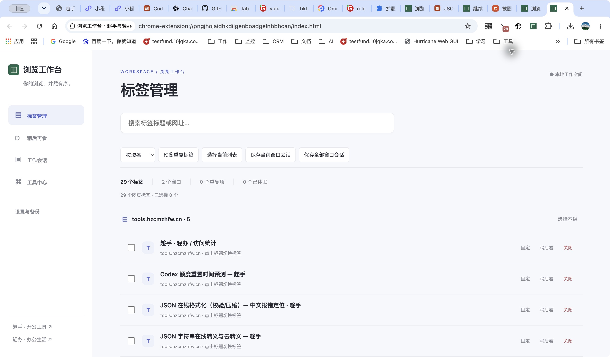
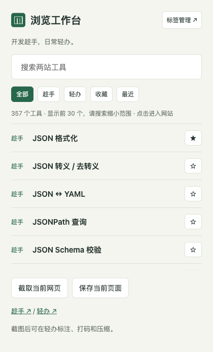
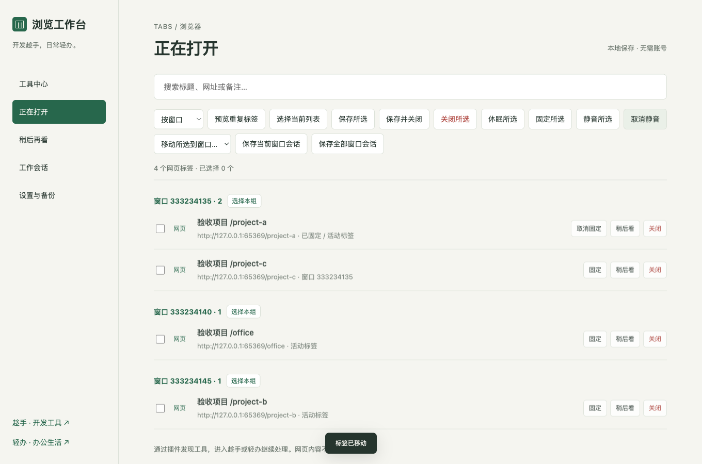
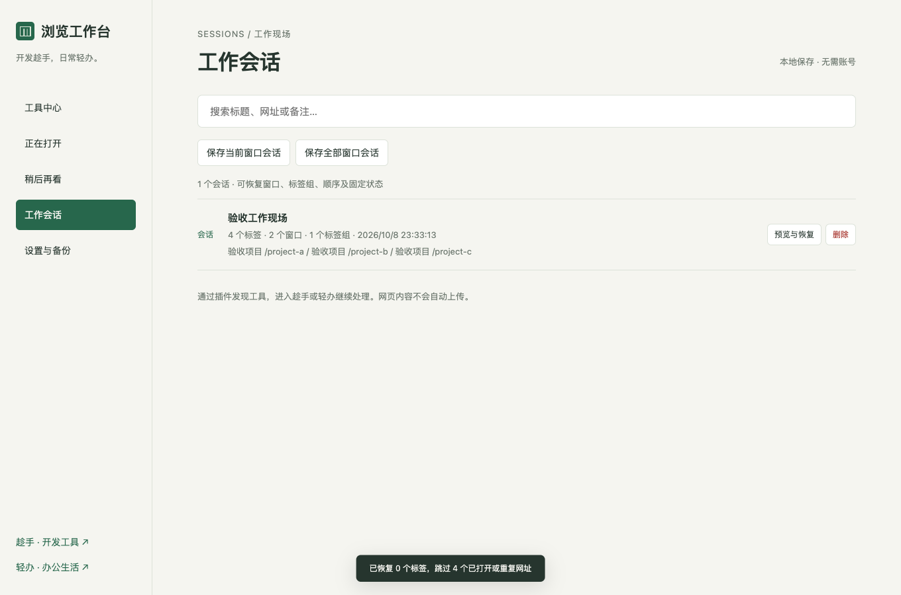
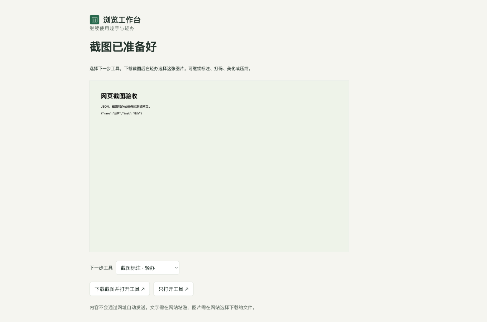
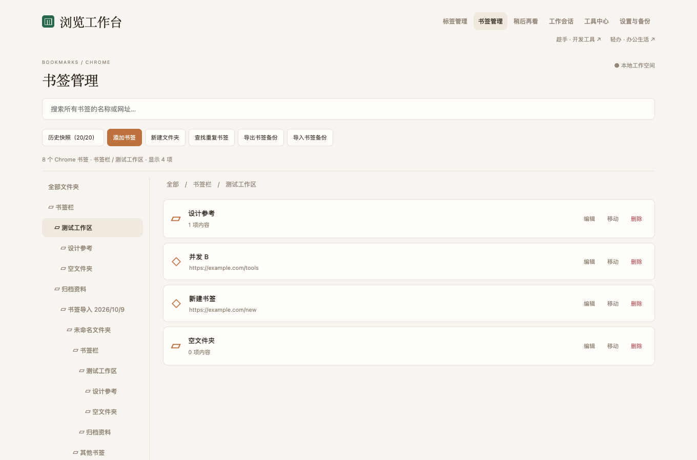
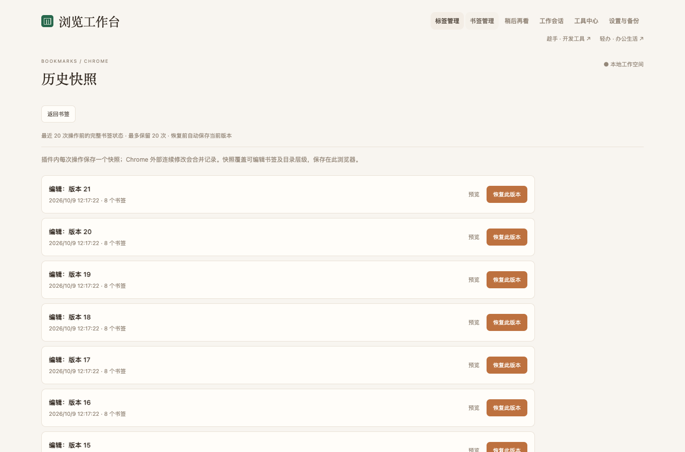

# 浏览工作台 · Tab Workbench

**整理浏览器标签，随手打开开发与办公工具。**

浏览工作台是一款从零开发的 Chromium 浏览器扩展。把标签搜索、稍后再看和工作会话放在一个工作台里，同时连接 **趁手** 与 **轻办**：选中文字、截取网页后，进入对应工具继续处理。

[进入趁手 · 开发工具](https://tools.hzcmzhfw.cn/) ｜ [进入轻办 · 办公与生活工具](https://qingban.hzcmzhfw.cn/) ｜ [两站导航](https://hzcmzhfw.cn/) ｜ [下载 1.2.0 插件 ZIP](releases/tab-workbench-1.2.0.zip)



默认打开标签管理，插件弹窗也优先显示标签。工具中心作为辅助入口保留在侧栏与弹窗的「工具」页。选中标签后显示批量保存、关闭、休眠、固定、静音与移动操作。

## 趁手与轻办，分别能做什么？

| 网站 | 适合的任务 | 常用工具 |
| --- | --- | --- |
| **[趁手](https://tools.hzcmzhfw.cn/)** | 开发、接口调试、数据与代码处理 | JSON 格式化 / 转模型、JWT、Base64、URL 编解码、SQL、正则、Cron |
| **[轻办](https://qingban.hzcmzhfw.cn/)** | 办公、图片、PDF、表格与日常计算 | 图片压缩、截图标注与打码、报名照片、PDF 合并拆分、表格清洗、二维码 |

插件提供两站 **357 个去重工具入口**：趁手 118 个、轻办 239 个（2026-10-08 目录快照）。无需为了找一个工具反复搜索网站；收藏常用工具，下次从插件直接打开。网站目录可能继续增长，可运行目录脚本更新插件入口。

## 安装：不用编译

目前采用「加载已解压的扩展程序」安装，尚未上架 Chrome / Edge 商店。

### 方法一：下载插件包

1. 下载 [tab-workbench-1.2.0.zip](releases/tab-workbench-1.2.0.zip)，在电脑上解压。
2. 打开浏览器扩展管理页，开启 **开发者模式**。
3. 点击 **加载已解压的扩展程序**，选择刚才解压后含 `manifest.json` 的文件夹。
4. 在浏览器扩展菜单中固定 **浏览工作台**，点击图标开始使用。

ZIP 需要先解压；它不是可直接双击安装的商店签名扩展。

### 方法二：从源码安装

```sh
git clone https://gitee.com/hzcmzhfw/tab-workbench.git
cd tab-workbench
```

在扩展管理页选择仓库内的 **`extension/`** 文件夹。安装和日常使用不需要 Node.js、Python 或 npm。

### 浏览器兼容

面向支持 Manifest V3 的新版桌面 Chromium 浏览器，基础 API 要求 Chrome / Chromium 110+。自动化验收使用 macOS 上的 Chromium 147 与 Chrome 155；其他品牌按相同扩展 API 适配，未逐一实机验收。

| 浏览器 | 扩展管理页 | 安装方式 |
| --- | --- | --- |
| Google Chrome / Chromium | `chrome://extensions` | 开发者模式 → 加载已解压扩展 |
| Microsoft Edge | `edge://extensions` | 开发人员模式 → 加载解压缩的扩展 |
| Brave | `brave://extensions` | 开发者模式 → 加载已解压扩展 |
| Vivaldi | `vivaldi://extensions` | 开发者模式 → 加载已解压扩展 |
| Opera | `opera://extensions` | 开发者模式 → 加载已解压扩展 |
| 其他 Chromium 浏览器 | 浏览器自己的扩展管理入口 | 需允许 Manifest V3 和加载本地扩展 |

不同发行版可能限制本地扩展、标签组或休眠。未提供标签组 API 时保留页面恢复，未提供休眠 API 时提示不支持。Firefox、Safari、移动浏览器和受企业策略限制的浏览器不在本版支持范围内。详见 [兼容说明](docs/compatibility.md)。

## 怎么使用？

### 1. 搜索与收藏工具

点击插件图标，输入 `JSON`、`PDF 合并`、`图片压缩` 等关键词；支持工具名称、说明和部分英文别名。点击结果进入具体工具页。

- 使用「趁手 / 轻办」筛选工具来源。
- 点击 **☆** 收藏，点击 **★** 取消收藏。
- 「最近」显示从插件打开过的工具；两站工具都支持收藏。
- 弹窗显示最多 30 个匹配结果；输入关键词缩小范围，完整工具目录在工作台中查看。



### 2. 管理正在打开的标签

点击弹窗的 **打开工作台**，或使用快捷键打开工作台，默认进入「标签管理」。

- 搜索标题和网址，按 **域名 / 窗口 / Chrome 标签组** 查看。
- 点击页面标题切换到对应标签和窗口。
- 选择单个标签、整组或当前列表，批量关闭、固定、静音或移动到其他窗口。
- 「预览重复标签」列出待关闭项，确认后清理；优先保留固定标签，再保留活动标签。
- 默认按完整网址去重；设置中可选择忽略 UTM 等已知追踪参数，业务参数保持区分。
- 「撤销关闭」重新打开本次操作关闭的网址，包括刚清理的重复副本；未提交内容无法恢复。撤销记录仅在本次工作台页面中保留。
- 「休眠所选」释放后台标签资源；跳过活动、固定、播放声音及已休眠标签。再次进入会重新加载，操作前请保存未提交内容。



### 3. 保存稍后再看的页面

在普通网页的插件弹窗点击 **保存当前页面**，或在「标签管理」中选择标签并点击 **保存所选 / 保存并关闭**。

输入收藏夹名称即可保存。相同收藏夹内按完整网址去重；支持标题、网址、备注搜索，移动收藏夹、阅读归档、批量打开和删除。批量打开会跳过已打开网址。

### 4. 保存与恢复工作会话

在「工作会话」选择 **保存当前窗口会话 / 保存全部窗口会话**，输入项目名称。

恢复时可以预览并选择部分页面，也可以按原窗口分别新建窗口。会话保留窗口归属、标签顺序、固定状态、标签组名称、颜色与折叠状态，自动跳过已经打开或重复的网址。

会话保存的是浏览布局与网址，不保存网页表单、滚动位置、登录状态、开发者工具状态或浏览历史。网页能否再次访问取决于原网站和当前登录状态。



### 5. 选中文字，继续处理

在网页中选中文字 → 右键 **使用趁手 / 轻办处理** → 选择工具。

| 趁手入口 | 轻办入口 |
| --- | --- |
| JSON 格式化 | 文本清理 |
| Base64 编解码 | 文本去重 |
| URL 编解码 | 字数统计 |

交接页中可切换相关工具，点击 **复制并打开工具**，然后在网站粘贴。JSON 可先在交接页进行简单格式整理。右键网页图片可进入压缩、转换或二维码识别流程；需要本地文件时先保存原图片，再在轻办选择文件。

在网页空白处右键还可选择 **当前页二维码**：复制网址后，在轻办二维码工具粘贴生成。

### 6. 截图后去轻办标注、打码或压缩

在要截图的普通网页点击插件图标 → **截取当前网页**。截图仅包含当前可见区域。

在预览页选择下一步工具 → **下载截图并打开工具** → 在轻办选择下载的图片。可继续做截图标注、马赛克、美化、压缩或格式转换。



**当前网站尚未接入通用输入传递协议**：文字需要复制粘贴，图片需要下载后选择文件；内容不会附在跳转网址中自动发送。浏览器内部页、商店页面等受浏览器限制，可能无法截图。

### 7. 备份数据与切换主题

在「设置与备份」选择跟随系统、浅色或深色主题。

导出 JSON 包含收藏工具、保存页面、工作会话及设置。导入支持：

- **合并导入**：保留现有数据，收藏和相同收藏夹内页面去重，会话新增，保留现有设置。
- **替换导入**：覆盖当前上述数据；请先导出备份。

浏览器之间的数据不会自动同步，但可通过备份迁移。临时截图与选中文字不进入备份。

## 快捷键

| 操作 | 快捷键 |
| --- | --- |
| 打开工作台 | Windows / Linux：`Ctrl + Shift + K`；macOS：`Command + Shift + K` |
| 聚焦搜索 | 工作台内按 `/` |
| 确认信息输入 | `Enter` |
| 取消对话框 | `Esc` |

快捷键冲突时，在各浏览器扩展快捷键设置页修改。

## Chrome 书签管理与历史快照

在顶部打开 **书签管理**。左侧选择 Chrome 原生文件夹，搜索框可搜索所有文件夹中的书签。

- 添加书签、创建文件夹、修改名称与网址、移动到其他文件夹。
- 删除前确认；非空文件夹需要先整理内容，最近一次删除可在本页撤销。
- **查找重复书签**比较完整网址，列出所有副本，由用户决定保留哪一项。
- 单独导出、导入书签 JSON。导入新建一个文件夹，不覆盖现有书签；这是插件 JSON 格式，Chrome 自带的 HTML 文件暂不支持。
- **历史快照**保留最近 **20 次操作前**的完整目录、名称、网址与顺序。支持预览和一键恢复，页面关闭或浏览器重启后仍然保留。
- 插件内一次编辑、移动、删除、创建或整批导入计为一次操作；Chrome 外部短时间连续修改合并为一个快照。
- 恢复前自动保存当前状态；可以再从历史恢复到恢复前的版本。恢复先暂存目标内容，再替换可编辑书签；Chrome 系统目录和组织管理书签不会直接修改。恢复会重建书签节点，Chrome 内部 ID 和添加时间可能改变。

修改直接写入 Chrome；开启 Chrome 同步时会由 Chrome 同步到其他设备。历史在本机保存，不随 Chrome 账号同步。卸载插件会清除历史，重要版本请导出备份。原有「稍后再看」及工具收藏独立保存。

从旧版本升级：在 `chrome://extensions` 找到浏览工作台，点击重新加载，并按 Chrome 提示启用新增的书签权限。本版新增 `bookmarks` 与 `unlimitedStorage`（为 20 份本地快照提供存储空间）。




## 权限与隐私

| 权限 | 用途 |
| --- | --- |
| `tabs` | 读取标题、网址与状态，切换、整理和恢复标签 |
| `storage` | 本地保存收藏、会话与设置，临时保存交接内容 |
| `activeTab` | 用户点击插件图标后截取当前网页可见区域 |
| `contextMenus` | 文字、图片和网页右键入口 |
| `tabGroups` | 读取并恢复标签组名称、颜色与折叠状态 |
| `bookmarks` | 读取、搜索、整理和恢复 Chrome 原生书签 |
| `unlimitedStorage` | 在本机保留最近 20 份完整书签快照 |

不申请全站网页读取权限，不注入内容脚本，不默认接管新标签页，无账号、遥测、广告脚本或自动上传。普通标签管理排除无痕窗口；无痕窗口中的右键交接不保存内容。

点击工具会正常访问对应网站并加载资源，遵循网站自己的隐私说明。保存页面与备份含网址、标题和备注，建议在个人浏览器中使用。详见 [隐私说明](docs/PRIVACY.md)。

## 开发与打包

运行时为原生 JavaScript / HTML / CSS，无生产依赖，无需构建。Python 3 用于目录更新和 ZIP 打包；Node.js 22+ 与 Playwright 用于验证。

```sh
npm ci
npx playwright install chromium
npm test
npm run check
npm run verify:bookmarks
npm run verify:browser
npm run verify:discard
npm run package
```

更新两站工具目录：

```sh
npm run catalog
npm run check
npm run verify:bookmarks
npm run package
```

`dist/tab-workbench-1.2.0.zip` 为打包结果，已发布包在 `releases/`。修改版本时同步更新 Manifest、package.json、README 下载链接，并将新 ZIP 复制到 `releases/`。

```text
extension/        可直接加载的扩展
scripts/          目录生成、检查、浏览器验收与打包
tests/            纯逻辑测试
docs/             兼容、隐私、验收记录与截图
releases/         版本化插件包
```

详见 [验收记录](docs/testing.md) 与 [更新日志](CHANGELOG.md)。浏览器自动化使用独立临时配置，关闭后清理；不会使用日常浏览器配置。

## 反馈

欢迎在 [Gitee Issues](https://gitee.com/hzcmzhfw/tab-workbench/issues) 反馈问题或建议。请附浏览器名称与版本、操作步骤及扩展错误信息；不要提交含敏感网址、截图或个人信息的备份。

**开发，趁手。日常，轻办。**

[趁手开发工具站](https://tools.hzcmzhfw.cn/) ｜ [轻办办公与生活工具](https://qingban.hzcmzhfw.cn/)
